# 石器时代 8.0 失落的世界 网页版

根据《石器时代8.0》原客户端的美术资源重新实现的 **HTML5 客户端 + Go 服务端**，浏览器打开就能玩。完整代码完全开放，随意自定义！

## 当前版本：v0.2.21-LYNX

v0.2.21-LYNX（SA-1115-03）审查并优化普通／快速／离线挂机。所有自动逃跑入口共用本场三次真实失败上限，之后回到战斗策略；人物逃跑时存活主宠仍防御。开启自动遇敌且启用自动／快速战斗时，野外按设置阈值用背包补给整备，先人物HP、参与宠物HP、再人物MP，肉优先，每秒至多一件；沿用原生效果、扣叠和存档。编辑设置、窗口与物品事务期间暂停，换图先停止遇敌，缺补给且HP≤20%时安全停止。战后先恢复再按既有设置丢肉。

离线角色在构建展示消息前跳过状态／背包／宠物／任务／战前展示，仍执行战斗、掉落、经验、培养、物品消耗和保存；在线队友仍收到离线队员HP。自动决策隔离基准由448B／5次分配降至0B／0次；离线展示组合由约88KB／1064次分配降至0。数字仅代表这些微基准，不代表整服CPU或内存同比例下降。

小地图左栏默认显示当前地图地点，9行分页，保留“区域”历史页；目录取实际有效跨图入口，合并相邻同目的地入口并保留所有入口格。现有资源中1206层识别3309处合并地点、5002个入口与目的地对应关系（条件源格可能对应多个目的地）；地图100列21处。点击村庄／洞窟自动走到可达入口并由服务器判定跨图。地图块先加载目标与路径走廊，再扩大绕路；未知格、非目标传送点与墙角规则保持。A*使用整数索引堆并避免重复节点，对明路先逐格验证后返回。

本轮按用户另行确认同步公开config.yaml：全图显示、4个角色位、人物转生上限7，经验1.2、掉落1.3、遇敌1.5、战斗播放1.6、防御机会0.7，地面宠物保留60秒。代码的默认／校验规则仍独立于配置。

匹配Linux AMD64与完整ZIP在 `bin/`，本轮没有新增Assets或数据库结构迁移。保留数据库／配置，正常SIGTERM存档停服后替换程序及外部客户端（如使用），重启、刷新网页；内嵌客户端随ELF更新。挂机意图与恢复令牌不跨服务重启，停服期间不补收益。详见[发布说明](docs/v0.2.21-LYNX.md)、[验收报告](Report/SA-1115-03/index.html)及[自动化维护经验](docs/skills/stoneage/references/automation-and-navigation.md)。移动验收为真实Chromium触屏／视口模拟，覆盖范围、具体计数与摘要以本轮最终报告为准。

## v0.2.20-LYNX

v0.2.20-LYNX（SA-1115-02）将宠物寄放总容量提升到500只，领取列表每页5只、最多100页，显示页码、容量与普通寄放／培养标记。所有宠物店新增“培养宠物”，收费为确认时（人物当前等级＋宠物当前等级）×100；确认后离开随身栏，进入共用仓库。所有正在培养的宠物各自取得人物每笔实际战斗经验的80%（向下取整），不分摊、不扣人物经验，并按原有成长规则自动升级。领取停止培养，普通寄放不获得培养经验。

培养复用普通、快速、自动、后台与组队的唯一战后结算入口，不设培养定时器或逐宠协程；500对象有界遍历，升级声望及家族存档合并结算，仓库每次只发5行。费用和宠物同一人物快照保存，确认绑定实际宠物与报价，拒绝过期对象、伪造页号/行号、容量不足、余额不足及禁止状态。旧宠物JSON默认不培养，无数据库结构变更，无新增Assets。

匹配Linux AMD64和完整ZIP在 `bin/`；保留数据库和配置，正常SIGTERM存档停服后替换匹配程序／外部客户端（如使用）、重启并刷新。详见[发布说明](docs/v0.2.20-LYNX.md)、[本轮报告](Report/SA-1115-02/index.html)及[培养维护经验](docs/skills/stoneage/references/pet-storage-training.md)。完整Go test/race/vet、TypeScript、244项客户端/构建、26项最终Chromium及78个HTTP文件一致性通过，两次构建摘要相同；两组隔离实例正常停服且存档一致。范围与最终摘要见报告；移动为Chromium触屏与视口模拟，未认证实体设备。

## v0.2.19-LYNX

v0.2.19-LYNX 恢复快速战斗前后的自动导航，地图支持输入准确 X/Y 坐标后“到目的地”。自动／快速战斗按恢复比例优先吃肉、其次药物、最后精灵，并按气力比例补气。新增默认关闭的“自动逃跑”（同场真实失败三次后恢复战斗策略）与“自动丢弃”（`|` 分隔名字关键字，日常与战后执行）。恢复原作相邻行动普通近战合击及同时出击播放。雷萨利朵右炮臂按肩关节抬臂瞄准开炮，升级到 `lisarido-v3`。详见[发布说明](docs/v0.2.19-LYNX.md)及[本轮报告](Report/SA-1115-01/index.html)。

自动丢弃无需确认，开启前请核对关键字；空关键字忽略，匹配为字面包含，装备／正在交易等占用物品不处理。更新资源执行 `bash update/install-lisarido.sh`，同步匹配程序与外部客户端（如使用），正常存档停服后重启并刷新网页。

本轮验证：244 项客户端／构建测试、完整 Go test／race／vet、TypeScript、42 项素材安装与 5 项艺术测试通过；最终程序真实 Chromium 桌面／移动共 29 项通过，57 个 HTTP 文件逐字节匹配，重复构建摘要一致。移动为触屏与视口模拟，未认证实体 Android／iOS／Safari；没有部署生产实例。

v0.2.18-LYNX 修正萨鲁法斯横向转身缩水，按主体高度保持等比例；奔跑加入蹬地、屈膝、前伸落脚、躯干俯仰与尾巴配合。克劳德斯也复核八向体积。双爪、莉莉丝和Lisarido均补全固定地面阴影，漂浮／落地关系分别校准。新图包为`primal-claws-v3`、`lilith-v2`、`lisarido-v2`，安装器先安装校验新包再自动清理已核实旧素材。执行三个`update/install-*.sh`并同步匹配程序／外部客户端，正常存档停服重启、刷新网页。未知或修改的旧内容保留并报错。详见[发布说明](docs/v0.2.18-LYNX.md)和[本轮可视报告](Report/SA-1114-05-angle-followup/index.html)。

素材制作与验收规则汇总为[stoneage skill](docs/skills/stoneage/SKILL.md)，包含方向、转向体型、跑姿、阴影、图集锚点和升级验证。

v0.2.18 验证：客户端／构建224项、安装器126项、四宠实战25项及移动交互14项通过；1192角色帧／76特效帧检查，69个HTTP文件逐字节匹配，重复构建摘要一致。移动验证使用Chromium触屏视口模拟，具体范围与中间验收失败保留在本轮报告。

v0.2.17-LYNX 修整萨鲁法斯与克劳德斯的战场体型及侧面动作。源图等比例缩放，按足底与身体中心定位，避免旧版把虎的西北／东南方向压窄近一半；优化髋部支点、摆腿、尾巴、金属细节与分层碎片。独立 `primal-claws-v2` 图包沿用宠物／技能／特效编号，安装时保留旧v1目录。待机镜头按人物与出战宠物的真实外框取景，修复横屏转竖屏时宽宠左侧被裁切。

v0.2.16-LYNX（SA-1114-05）新增萨鲁法斯与克劳德斯：地5风5与水5火5，成长档位和面板总额匹配杨格斯，分别侧重防御／敏捷与防御／耐久。自然栖息于漆黑洞窟地下17层（32017）与16层（32016）。**洞窟非1级个体只有攻击、防御；1级个体拥有共用技能。** 故事完整进入原生图鉴，分别记述原始人使用ChatGPT改造佩露夏、使用Claude创造洞窟守护者。

共用技能选择目标及前后左右原生槽位邻居，普通命中率80%；施放者自身防御随机增加30%–60%，持续5回合，耐力沿用原生防御语义，只加一次。指定头目与天空岛实际敌人编号受到150%伤害；防御／石化对象必定命中、破防并受到150%，已猛毒对象受到120%，其余普通对象正伤害命中且存活、无异常时，按等级差与非负毒抗性计算28%–43%概率附加原生猛毒。整次实际造成伤害总额的1.8%回复自身HP，按总额向下取整并限制最大HP；反射致死不复活。倍率分支择高且不相乘，继续遵守原生实际承伤者、守护、反射、死亡和捕获保护规则。

原图八向分层制作奔跑、摇尾、后腿站起左红爪扫击，以及爬行、红眼、跳跃左红爪刺击与相应红痕；出击与回位使用原生近战路径。体型参照金格萨贝鲁与洛奇安的原生尺度包络；不同姿态保持上传原图骨架比例，以足底校准锚点，不强行匹配参考宠物每向外框。执行 `bash update/install-primal-claws.sh` 安装独立七文件素材补丁，自定义目录使用 `--assets /实际路径/Assets`。移动原生全屏UI、按钮缩放、禁双指缩放与横竖屏镜头继续保留。

匹配Linux AMD64、替换ZIP、可复现证据与验证限制见 [发布说明](docs/v0.2.17-LYNX.md) 和 [素材验收](Report/SA-1114-05-art-polish/ACCEPTANCE.md)；宠物与技能原始证据见 [SA-1114-05](Report/SA-1114-05/ACCEPTANCE.md)。Assets原树、数据库与凭据不上传；Chromium触屏模拟不代表实体Android/iOS或Safari认证。

## v0.2.15-LYNX

v0.2.15-LYNX（SA-1114-04）新增雷萨利朵：火7风3，佩露夏同档成长，偏攻击与敏捷，栖息于玄黄洞窟地下二层（11202，40,40附近）。八向原生漂浮动画保留右手炮筒，猫耳微动、普攻举炮近爆；主体98px，与莉莉丝一致，约为雷龙正面角色高度的2/3。

电磁火炮原地连续发射5次，每发从当前合法活敌随机选择一个目标，按原生物理规则结算15%–18%伤害系数。每发先等概率选择麻痹或驱离，再分别按20%–50%或10%–30%的概率判定；同一发只判定一类效果。驱离保护PvP、NPC/事件战、禁逃楼层和不可捕获的特殊敌人；死亡、逃离、击飞、隐身及捕获保护目标会被实时排除。桌面与手机均按原生事件逐炮播放。

安装新素材：`bash update/install-lisarido.sh`。独立五文件补丁与之前两扩展隔离；三个安装器修复了有效USTAR归档末尾填充的边界误拒绝。原生移动全屏UI、按钮缩放、禁双指缩放与转屏镜头继续保留。源码、匹配Linux AMD64、替换ZIP及验证范围见 [发布说明](docs/v0.2.15-LYNX.md) 和 [本轮验收](Report/SA-1114-04/ACCEPTANCE.md)；Assets原树、运行数据库与凭据不上传。

## v0.2.14-LYNX

v0.2.14-LYNX（SA-1114-03）修复不能行动的单位仍反击，以及异常到期事件重新显示旧状态的问题。自动／快速战斗按“补血时机”严格低于阈值恢复人物、宠物和仍在骑乘的坐骑；无法治疗的低血量对象不会挡住其他对象的恢复。优先使用可施放的恢复精灵，再用肉与耐久恢复品；需要补气时只选择战斗中实际恢复气力的道具，避免混合料理误用。客户端补齐滋润类精灵、复活药识别和无活敌时防御的回退策略，设置说明与权威行为一致。

新增漂浮宠物莉莉丝：风8火2，与佩露夏同档成长并偏攻击与高敏，分布在吉鲁岛幽风林缘；普通攻击释放蓝紫能量，幽灵风暴原地攻击敌方全体并有35%–80%石化概率。相簿、宠物详情与GM目录已接入；角色高度按雷龙系约2/3控制。更新后执行 `bash update/install-lilith.sh` 安装独立增量素材，支持自定义Assets目录与幂等校验。

移动设备原生全屏适配、按钮缩放、禁双指缩放和横竖屏镜头锁定继续保留。实现、验证与边界见 [发布说明](docs/v0.2.14-LYNX.md) 和 [本轮报告](Report/SA-1114-03/ACCEPTANCE.md)。新增素材只通过update补丁分发，原Assets目录不上传。

## v0.2.13-LYNX

v0.2.13-LYNX（SA-1114-02）完善手机全屏原生窗口：宠物打开时显示基本列表，点击名字进入详情并播放原生站立动画；人物状态显示原头像，四属性旁直接提供原生“+1”，点数由服务端确认，耗尽后移除操作；道具保留真实 CG 图片、名称及说明，按权威字段区分人物/宠物装备、可用道具与其他物品，下方明确显示“装备／使用／卸下”，恢复道具沿用原目标选择。动态图串行解码并限制缓存，关闭、换宠、切屏及减少动态效果设置均控制播放，无新增 Assets。

移动全屏行走与战斗只通过按钮缩放，双指手势不再缩放或平移场景；横竖屏镜头锁定修正详见 [本版说明](docs/v0.2.13-LYNX.md)。实际验收、发行文件及限制见 [本轮报告](Report/SA-1114-02/ACCEPTANCE.md)。

## v0.2.12-LYNX

v0.2.12-LYNX（SA-1114-01）修复战斗HP0与击飞离场的状态分歧：HP≤0不能行动；普通倒地可以明确复活，击飞/逃跑则不能在本场复活，避免已离场敌人从空位攻击或受伤。敌人复活、咒术、道具与服务端自动策略统一过滤离场单位，合法复活重置击杀归属；客户端所有HP更新同步倒地状态，补齐致死毒伤，拒绝已离场模型的迟到命中。自动与快速战斗复用这套规则，活宠与队友仍能继续各自回合。

手机“界面→游戏画面→全屏游戏界面”的菜单、NPC、提示、登录和战斗子菜单都保持设备全屏，在游戏视口内部重排原生窗口与图标。背包使用原槽位/道具CG图格，宠物卡片将HP、状态和操作放在一起，详情显示原模型；地图轻点寻路与拖动平移复用原游戏输入。竖屏滚动，较宽横屏信息/指令分列；鼠标与缩放收于“更多操作”，真实输入框保留。皮肤使用既有Assets并串行缓存解码，无新增素材；桌面展示分支冻结。详见 [本版说明](docs/v0.2.12-LYNX.md) 与 [实际验收及限制](Report/SA-1114-01/ACCEPTANCE.md)。

v0.2.11-LYNX（SA-1113-04）新增独立的手机**沉浸模式**。右侧“界面”选择“沉浸”后，地图和普通战斗按原800×600场景等比放大铺满可见窗口，默认至少保留1个原场景像素对应1个CSS像素；人物不再整体缩成屏宽缩略图。地图保持人物附近的视野，战斗镜头跟随出招与受击，也可切换“我方 / 敌方 / 跟随”；目标列表保留真实名字、HP和原生指令。菜单使用完整画面预览与可滚动的大字按钮，战斗子菜单打开时恢复完整预览，关闭后回到沉浸场景。快速战斗继续显示地图。传统手机模式和桌面完整4:3画面仍可随时选择。支持的平台可用“进入全屏”隐藏浏览器界面；原生全屏不可用时仍可铺满网页窗口。入口也支持 `?device=mobile&view=immersive`，显示偏好独立保存。

动态动作按原生热区的行、列位置排列，同一行的名称与操作保持对齐；长列表独立滚动、复用按钮节点以保留焦点。沉浸模式提供可收起的菜单/操作抽屉，触控按钮至少44px，位置、缩放、输入取消与界面模式仍沿用原公共层。战斗顶部HP/MP来自当前播放中的人物状态，避免显示入场前的旧血量。

自动策略修复重复MP折扣、地图道具误入战斗、全体复活目标和固定宠物攻击破坏捕捉的问题。多人队伍按合法捕捉计划协调目标；自动攻击、连击、反击、攻击精灵范围及守护拦截均在结算时检查实际伤害对象，手动指令保留原意。回复精灵优先选择估算足够的小回复及较低实际MP消耗。敌人策略缓存不变的权重表，每回合重检技能和活目标，自身/群体技能使用正确阵营；观战队员不会同时被队长拉入另一场战斗。

服务端复用同一不可变移动事件，减少多人视野广播分配；仅对内嵌HTML/JS建立有界gzip副本，外部客户端保持热更新，Assets不进入该缓存。SIGTERM停止业务后真正等待人物及共享家族存档队列排空、退出，再关闭数据库，移除原10秒提前结束。已取出但尚未投递的邮件在断线/停服时整批原子恢复，新邮件仍受50封准入限制。SQLite继续采用WAL/FULL与单机单写者；磁盘错误、强杀及断电仍需按日志和备份处理。具体复现、性能测量与验证范围见 [发布说明](docs/v0.2.11-LYNX.md) 和 [本批验收](Report/SA-1113-04/ACCEPTANCE.md)。无新增Assets素材。

v0.2.10-LYNX（SA-1113-03）修复战斗可读性与倒地后的挂机策略。HP/MP移至人物、宠物外形下方；伤害使用黄色粗体描边并约束在画面内，覆盖五敌顶部位置；HP0快照与后续回合维持双方倒地姿态，复活恢复动作。PvE单人多宠和多人队伍的主人倒地不再触发无效逃跑/全宠防御，活宠按自身技能与有效目标继续自动和快速战斗。无前台或观战者的后台战斗跳过展示消息构造，真实模拟、经验奖励与实时恢复继续执行。移动端摇杆控制区排在智能按钮列表之前，长列表独立滚动；可遇敌野外提供由服务端状态确认的自动遇敌快捷开关。变更、复现与验证边界见 [发布说明](docs/v0.2.10-LYNX.md) 和 [本批验收](Report/SA-1113-03/ACCEPTANCE.md)。无新增Assets素材。

v0.2.9-LYNX（SA-1113-02）增加独立浏览器会话与按角色接管：密码登录进入线路/角色选择，不影响同账号其他角色；选择已在线角色恢复实时世界与战斗快照。返回角色选择和退出账号保留后台角色，选择页显示在线/后台挂机标识；明确停止挂机请先关闭自动遇敌与快速/自动战斗。浏览器恢复令牌按标签页存放，密码变更撤销其他会话，服务器重启需重新认证。

小地图支持顶层 `minimapReveal: 0`（默认，保留探索）或 `minimapReveal: 1`（全开），只接受整数0/1。地图按小块加载，点击小地图或当前楼层地图即可规划绕障路线；墙体、斜角穿墙与不可达目标均受校验。手动方向输入取消路线；服务器仍逐步校验位置与速度。

奥普埃、克劳德、格鲁克、吉米奈提升至佩露夏同档成长预算，分别侧重均衡支援、耐久防守、高速物攻与双核突击；持有与寄存的旧版四宠加载时幂等升级，保留身份、技能和养成差异。战斗头顶采用高对比数值血条，手机放大血量与伤害字体。没有追加美术素材，沿用已有机械宠增量包。

持久化增强包括原子表结构升级、旧经验转换与完成标记整体事务、留言编号事务、邮件容量/取删原子操作、收件与排行索引、FULL持久性设置以及数据库路径转义；后台角色跳过无消费者的视野扫描，切角释放旧地图监听器和缓存，目录请求关闭探测句柄，HTTP停服等待完成后再释放数据库。SQLite仍为单机单写者，不提供多节点故障切换。证据和限制见 [本批集成记录](Report/SA-1113-02/INTEGRATION.md) 及 [最终验收](Report/SA-1113-02/ACCEPTANCE.md)。

v0.2.8 引入四位原创机械伙伴：奥普埃、克劳德、格鲁克和吉米奈，配有八方向战斗动画、独立定位、自然捕获区域和故事图鉴。服务器 `git pull` 后，在 `update/` 执行 `bash install-ai-pets.sh` 安装新增素材；原素材目录不会上传Git。设计与分布见 [四宠说明](docs/v0.2.8-LYNX.md)，部署与安全校验见 [增量升级说明](update/README.md)。缺少新增素材时回退原机械宠形象，不影响服务器运行。

本版也包含人物/宠物独立等级与转生上限、按实际击败敌人结算的可配置石币奖励、浏览器关闭或冻结后继续的服务端挂机，以及单人最多五宠、按队伍人数共享五个宠物位置的战斗。登录封面更新为原创 4:3 插画，桌面和手机继续使用真实账号/密码输入。配置默认、部署示例、奖励取整、会话恢复和 AI 差异见 [v0.2.7-LYNX 发布说明](docs/v0.2.7-LYNX.md) 与 [使用手册](docs/手册.md)。最终发行文件摘要和验收状态以 v0.2.8 同批交付记录为准。

本仓库集成了与原二进制对应的上游 v0.2.3 源码（`b28455eb9e25033ded04bd5ac43f6f143b26e6be`），增加手机适配；桌面保留原 800×600、4:3 完整画面和鼠标操作。触屏手机自动启用可读面板与八方向摇杆；经典模式支持双指缩放与平移，全屏模式只用按钮缩放。竖屏默认游戏等比铺满屏宽；横屏游戏按高度尽可能铺满并居中，独立左轨放菜单/摇杆，右轨放选项切换和鼠标左右键。经典模式双指只缩放游戏画面，控制器不缩放；直接点击游戏画面仍使用原操作。长按按钮650ms可拖动，摇杆需在静止中心长按；位置按横竖屏分别记忆，可随时“重置按钮位置”。右侧“界面”可选择自动、桌面或手机，也支持 `?device=auto|desktop|mobile`。

交付文件为 `bin/saserver`（静态 Linux AMD64）与 `bin/saserver.sha256`。该二进制内嵌匹配的网页客户端，默认 `client: client` 即使用内嵌版本；需要自定义外部页面时设为 `client: ./client` 或其他明确目录。运行仍需要 `config.yaml`、`gamedata/` 和单独下载的 `assets/`，数据库沿用配置的位置。

在项目根目录执行：

```bash
sha256sum -c bin/saserver.sha256
bin/saserver --version
bin/saserver
```

从源码构建本版本执行 `scripts/build-linux.sh`，使用 Node.js 24+ 和 Go 1.27.3+；本批实际使用及CI对齐 Node.js 26.13.1、Go 1.27.3，可设置 `GO_BIN`、`VERSION`。脚本先构建网页、复制到嵌入目录，再构建二进制，避免网页与二进制不一致。客户端缓存版本由源码、页面与登录 PNG 内容计算，相同输入重复构建保持一致。仅 `art/login.png` 进入登录图片发布入口；可编辑 SVG 与字体许可留在源码中。

资源使用官方 [assets-v0.2.3.zip](https://github.com/OpenGameSys/stoneage-web/releases/download/v0.2.3/assets-v0.2.3.zip)，压缩包大小 **1,233,027,874 字节**，SHA-256 为 `d675799f8ba5cf1338c6c32e0bca788076a4da4ab990a5f8234ef7bcbeff2baf`。压缩包自带 `assets/` 顶层目录，解到项目根目录，确认 `assets/manifest.json` 存在。资源文件未纳入本仓库；本地已下载并校验的副本可以直接运行。

v0.2.5-LYNX 完成一轮发行前审查：修复手机面板后继续寻路、交易返回漏取消、桌面模式控件内方向键释放与输入法回车误提交；减少静止页面的重复DOM写入，JS支持ETag/304重验证；构建拒绝未知嵌入文件并清除旧模块，服务端支持SIGTERM保存在线角色后退出。协议、游戏数据和数据库结构保持兼容。

手机操作与既有适配边界见 [手机适配说明](docs/手机适配.md)。v0.2.7 的专项记录包括 [服务端挂机](Report/SA-1112-04/AUTOMATION-REVIEW.md)、[会话恢复](Report/SA-1112-04/SESSION-REVIEW.md) 与 [登录封面设计](Report/SA-1112-04/art/DESIGN.md)；这些专项验证不替代最终发行验收。v0.2.6 的 [布局与控制器验收](Report/SA-1112-03/ACCEPTANCE.md)、历史 [发行前审查](Report/SA-1112-02/ACCEPTANCE.md) 和 [首次适配](Report/SA-1112-01/ACCEPTANCE.md) 证据保留。Linux部署时请发送SIGTERM并留出存档时间；SIGKILL无法执行保存。

## 项目介绍

- **客户端**：TypeScript + WebGL2，不依赖 npm 与任何框架。8 位图用调色板纹理查色，所以昼夜调色板切换和原版一样平滑；
  画面是 800×600（4:3），按浏览器窗口等比缩放，按屏幕的实际像素渲染（放大、缩小、高分屏都不糊）。
- **服务端**：Go，单进程。每条线路是一个单协程的世界，WebSocket + JSON 协议（`proto/messages.json` 是唯一的定义，两端代码都由它生成）。
  存档用 SQLite（纯 Go 驱动，不需要 cgo），服务端权威：客户端只发意图，服务端校验后广播结果。
- **数据**：`gamedata/` 是原版服务端的地图、NPC、道具、敌人、技能等数据；`assets/` 是从原客户端资源导出的 WebP 图集、动画与 Opus 音频。
- **规模**：1370 张地图、2156 个 NPC、5618 个传送点，原版的战斗、宠物、道具、社交系统都已实现（见下面的"已实现功能"）。

不兼容原版的线路协议，也不兼容原版 Windows 客户端。**本项目只用于学习与研究！！！**

## 截图

| | |
|---|---|
| 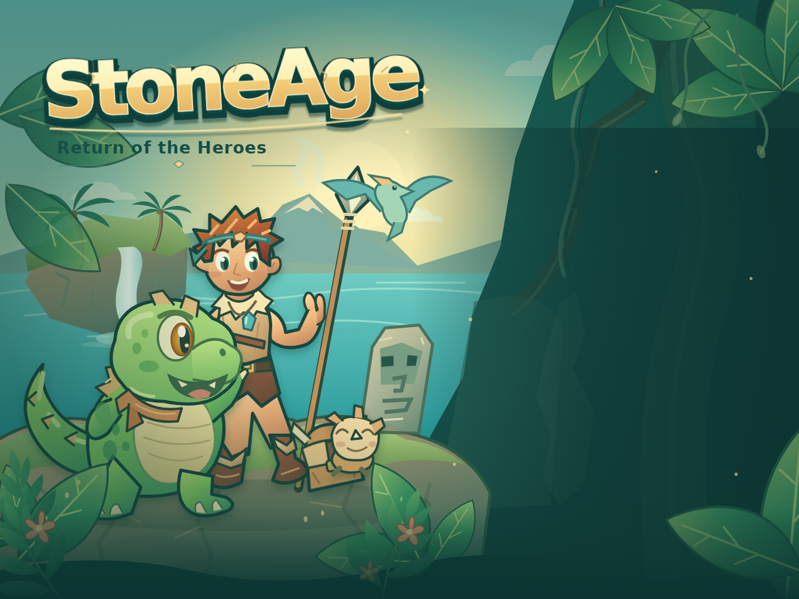 StoneAge / Return of the Heroes 新登录封面 | 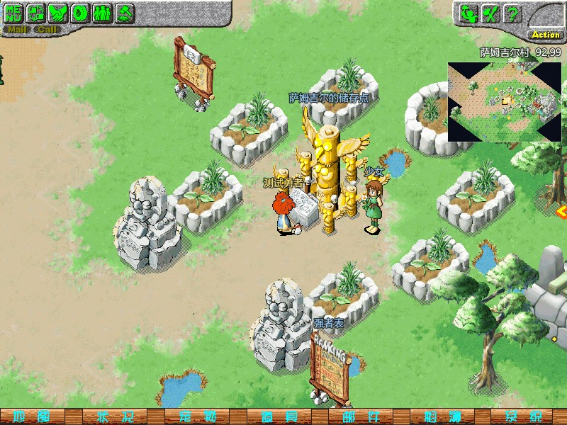 萨姆吉尔村：画面上方按钮、右上角楼层名与小地图、底部任务栏 |
| 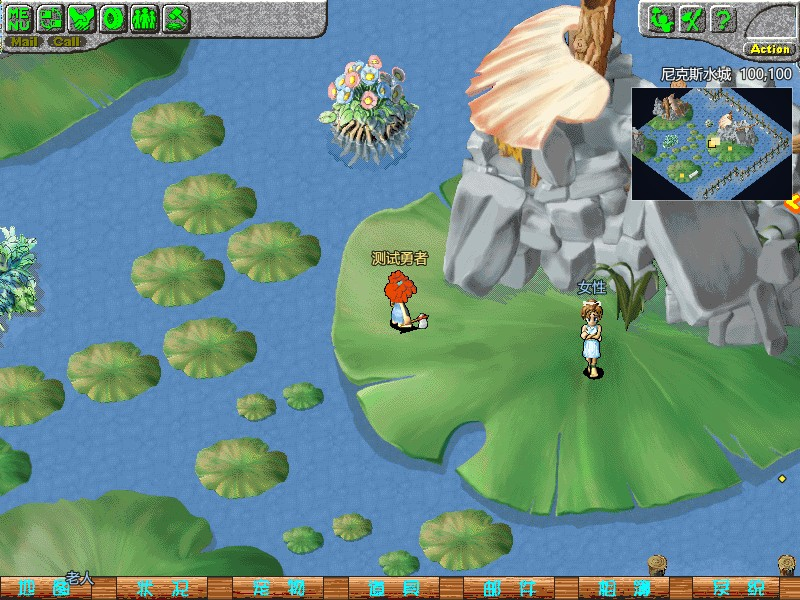 尼克斯水城 | 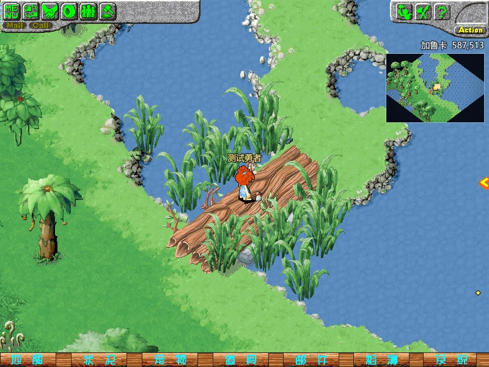 加鲁卡的木桥（贴地物件画在角色下面） |
| 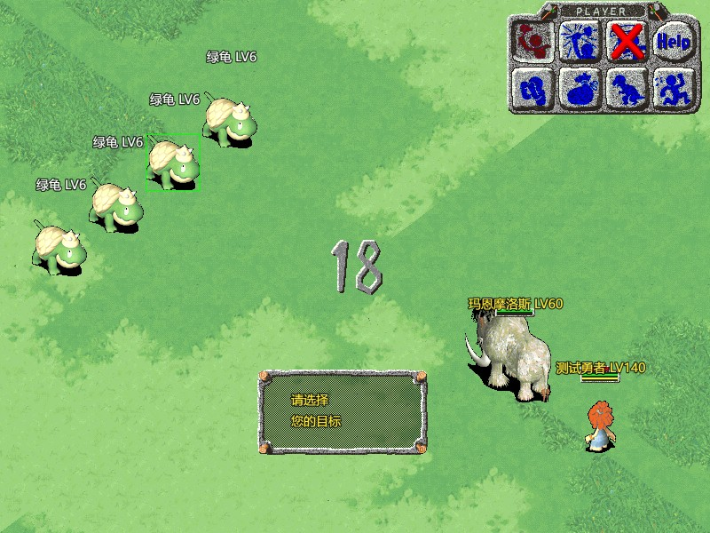 回合制战斗，敌人头上常显名字与等级 | 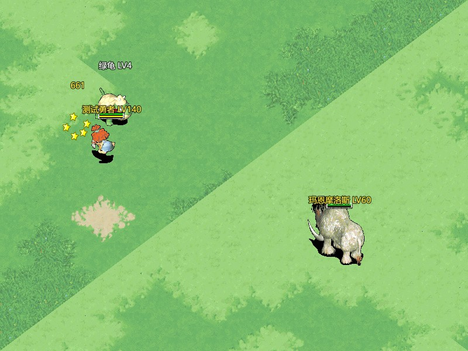 攻击演出：伤害数字、打中的星星 |
| 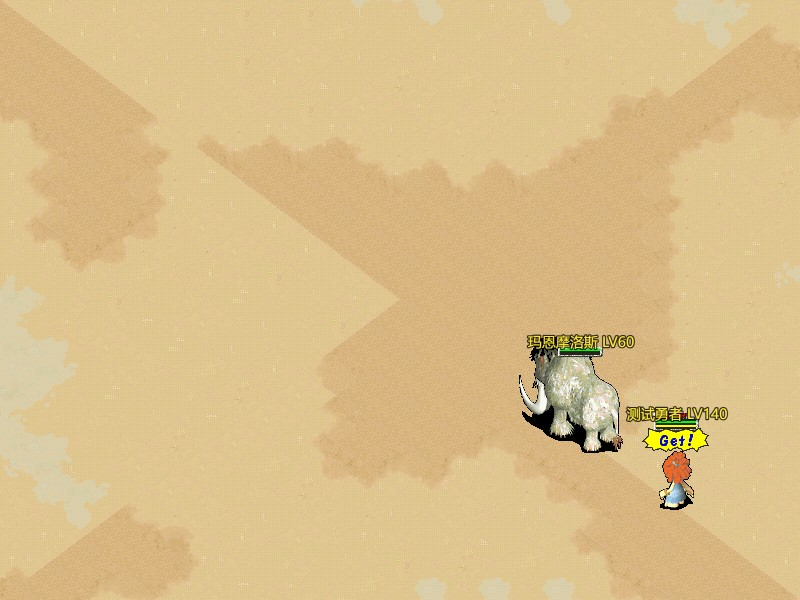 捕捉宠物 | 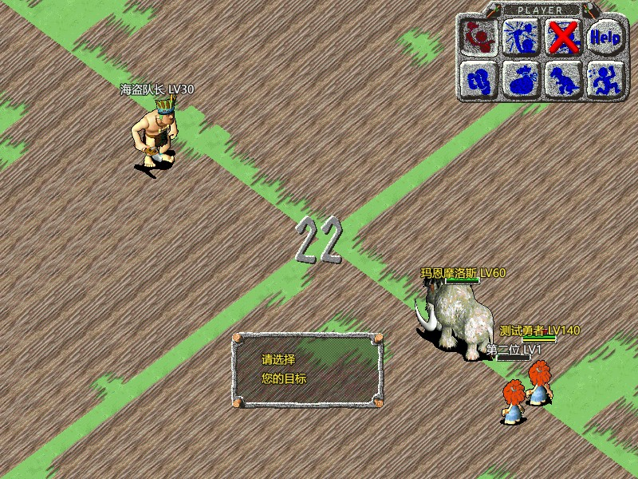 组队战斗 |
| 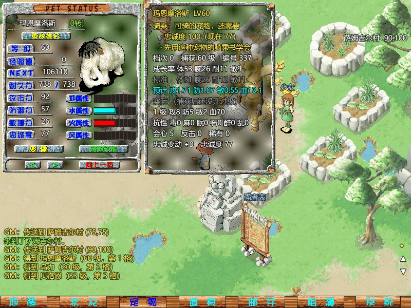 宠物详细资料与扩展资料（含能不能骑） | 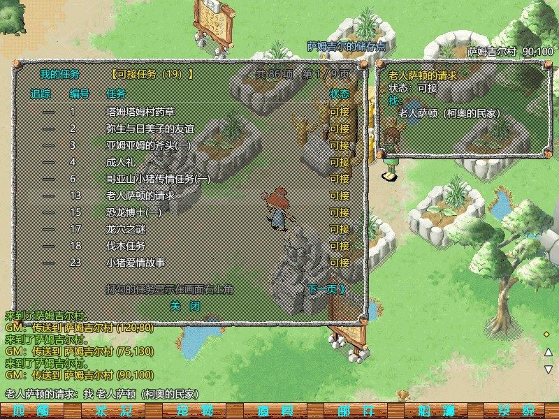 任务查询：可接任务与要找谁 |
| 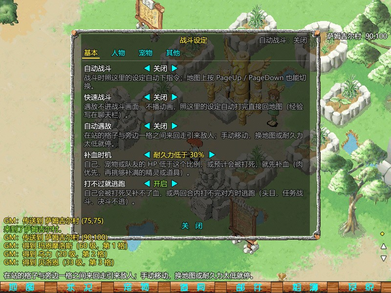 战斗设定（智能战斗、自动遇敌、补血时机） | 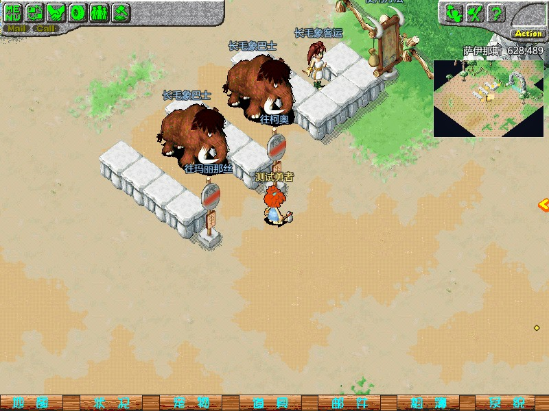 萨伊那斯的长毛象巴士站 |
| 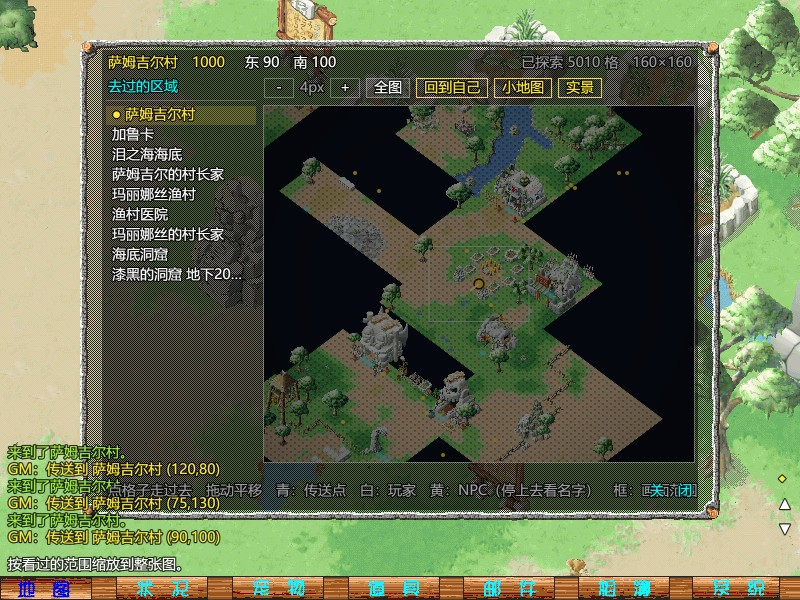 世界地图：看过的区域、去过的楼层、缩放与拖动 | 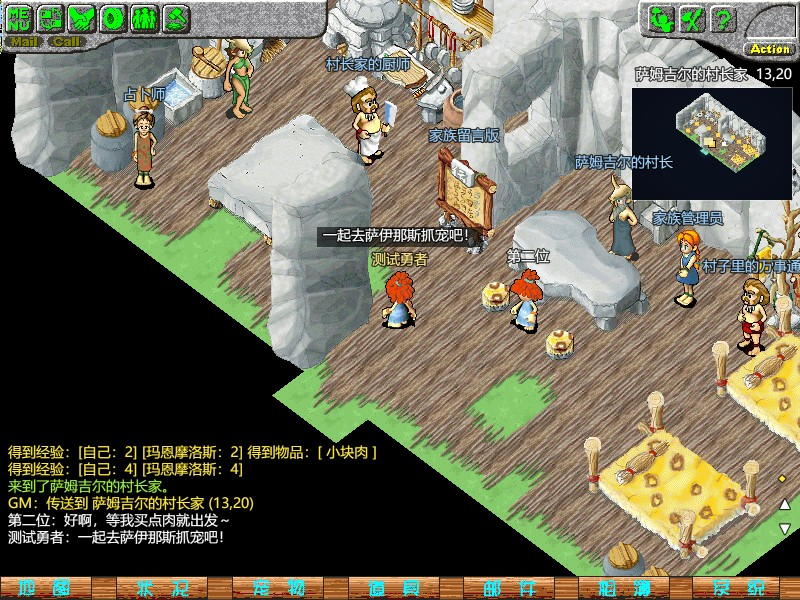 头顶聊天气泡与聊天栏 |
|  摆摊：头上的招牌与地上的货摊 | 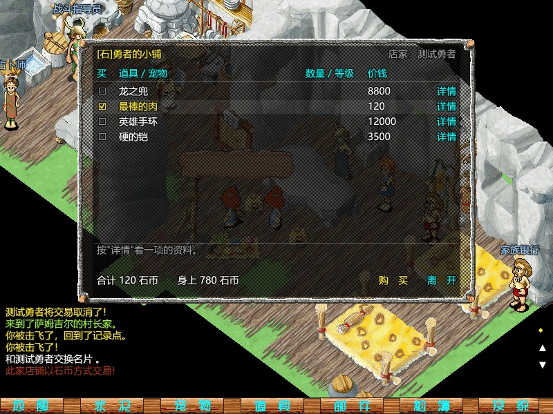 面向店家看清单、勾选购买 |

使用手册（架设、设定、玩法、GM 指令）见 [docs/手册.md](docs/手册.md)。

## 快速开始

### 方式一：直接用构建好的发布包

到 [Releases](https://github.com/OpenGameSys/stoneage-web/releases) 下载两个文件：

| 文件 | 内容 |
|---|---|
| `saserver-<版本>-<平台>.zip` | 服务端（`windows-amd64` / `linux-amd64` / `darwin-arm64` 三选一）、客户端页面、原版数据 `gamedata/`、`config.yaml`、手册 |
| `assets-<版本>.zip` | 美术与音频（约 0.9 GB，三个平台共用） |

1. 解开平台包；
2. 把 `assets-<版本>.zip` 解到平台包里的 `assets/` 目录（解完 `assets/manifest.json` 要在这个位置）；
3. 启动服务端（没有命令行参数，设定都在 `config.yaml`）：

```bash
bin/saserver.exe
```

Linux / macOS 是 `bin/saserver`（第一次要 `chmod +x bin/saserver`；macOS 若提示无法验证开发者，`xattr -d com.apple.quarantine bin/saserver`）。

浏览器打开 `http://127.0.0.1:8800/`，在登录页点"注册新账号"，选线路、建角色就能进游戏。

### 方式二：从源码构建

需要 [Go 1.27+](https://go.dev/dl/)（服务端）和 [Node.js 24+](https://nodejs.org/)（客户端，只用来去掉 TypeScript 类型，不需要 `npm install`）。
`gamedata/` 已包含在仓库，`assets/` 需按上面的资源说明单独下载。当前内嵌客户端版本请优先用 `scripts/build-linux.sh` 完成整体构建；以下命令保留上游开发流程的说明。

在 `server` 目录编译服务端：

```bash
go build -o ../bin/saserver.exe ./cmd/saserver
```

回到本目录构建客户端：

```bash
node client/build.mjs
```

启动服务端：

```bash
bin/saserver.exe
```

然后同样打开 `http://127.0.0.1:8800/`。在 `server` 目录跑测试（用 `gamedata/` 的真实数据）：

```bash
go test ./...
```

### 设定

设定档 `config.yaml`：监听地址 `addr`、数据与资源目录 `data` / `assets` / `client`、资料库 `db`、允许的页面来源 `origins`、
大区与线路 `groups`、GM 账号 `gms`（可以多个，例如 `gms: [admin, tester1]`；GM 在系统窗口有"GM 指令"选单，也可以在聊天输入
`/warp 楼层 x y`、`/item 编号`、`/gold 数量`、`/lv 等级`、`/pet 敌人编号 等级`、`/encount`、`/heal`、`/goto 名字`、`/fm …` 等）。
另有日志等级 `log`、每个账号的角色位 `maxChars`、HTTPS / WSS 用的 `tlsCert` / `tlsKey`（对外开放时请一定设定，否则账号密码是明文），以及游戏规则 `rules`：经验倍率、经验共享、战利品倍率、遇敌倍率、每回合秒数、升级加点、
地上东西消失的时间、成立家族的手续费、不能逃跑的楼层、世界频道的门槛（原版要 5 转 140 级、每句扣声望）（没写的项目用原版的值，说明见 `config.yaml` 里的注释）。
相对路径以 `config.yaml` 所在的目录为准；同目录的 `config.local.yaml` 可以盖掉其中的项目，例如本机开发时写一行 `gms: [tester1]`。
网页参数：`?debug` 显示帧率、绘制次数与最近 2 分钟和服务端往来的消息数、流量，`?hits` 画出所有点击热区。

## 文件目录说明

```
assets/          从原客户端导出的资源：WebP 图集页、图像清单、动画 JSON、地图图号表、调色板、Opus 音频（约 0.9 GB），
                 以及打包好的资源索引 index.bin.gz（server/tools/assetindex 产生）
gamedata/        原版服务端数据：map/（LS2MAP 地图、通行、传送点）、npc/（NPC 摆放与参数）、item/、battle/、ride/、question.txt
proto/           messages.json：唯一的协议定义
server/          Go 服务端
  cmd/saserver     入口：同一个端口提供 WebSocket（/ws）、资源（/assets/）与客户端页面
  internal/data    读取 gamedata
  internal/store   SQLite 存储（Store 接口，可以换成别的数据库）
  internal/world   世界：移动与视野、聊天、NPC、战斗流程、道具、宠物、组队、交易、邮件、家族、庄园……
  internal/battle  回合制战斗规则（纯逻辑，可注入随机数）
  internal/server  WebSocket 会话：登录 → 选线路 → 角色 → 世界
  tools/protogen   由 messages.json 生成 Go 与 TypeScript 代码
  tools/assetindex 把图像清单与动画打包成 assets/index.bin.gz（资源重新导出后在 server 下 go run ./tools/assetindex）
client/          浏览器客户端
  src/             TypeScript 源码（proto.gen.ts 是生成的）
  art/             登录 PNG、可编辑 SVG 与字体许可（仅 login.png 对外发布）
  build.mjs        去掉类型输出到 dist/
  index.html       只有画布，界面全部画在 WebGL 画布与 2D 覆盖层上
  test/            点击移动路线的单元测试（node client/test/route.test.ts）
bin/             编译出的 saserver.exe 与运行时生成的 saserver.db
config.yaml      服务端设定（config.local.yaml 是本机覆盖，不进 git）
```

## 已实现功能

- **登录前**：原版风格的账号登录、大区与线路选择、角色选择、三步建角（形象与颜色 → 名字、长相、点数、属性 → 出身地），建角规则照原服务端。
- **地图与移动**：原版地图与通行规则、传送点、昼夜调色板、多人同屏与移动同步、点击移动（原版 getRouteMap）、跟随模式、世界地图；伊甸大陆等区域的 NPC、地图、遇敌与道具由石器 8.0 的数据补全（不含私服内容）。
- **聊天**：附近（原版的音量与 `!` 范围、悄悄话）、队伍、家族、世界频道，文字颜色、头顶气泡。
- **NPC**：村民、告示牌、护士、传送员（免费 / 付费 / 门票 / 暗语 / 条件）、万事通、记录点、按时间出现的人、道具店与寄放店、传言板、
  美容师、占卜师、猜拳道场、猜谜、道具兑换、麦克风、看动作的人、任务交换（340 个）、战斗 NPC（道场、魔王、守门的敌人）、宠物店、宠物技能店、
  骑乘训练师、决斗强者表、家族管理员、家族留言版、家族银行、庄园的秘书与小护士、长毛象巴士与加美航空（沿路线连续走动、乘客跟着走，速度由 `rules.busStep` 调）、
  庄园争夺战与家族 PK 场的踢馆登记人 / 场地预约人 / 对战向导 / 召唤员 / 服务员。
- **转生**：漆黑的洞窟地下 20 楼的精灵王，人物前 6 转与宠物前 2 转保留原公式和 NPC 条件；两者次数上限独立可配，原范围以外采用有界扩展（见发布说明），保留守护兽、清任务旗标和转生宠物等流程；跟放在地上的宠物说话（玛蕾菲雅靠这个把等级上限从 10 一段段提到 79，pet_event.c PET_Talkfunc）；溜宠（宠物项圈 / 玛蕾菲雅的项链让宠物跟着走）；转生过的人装备道具不看等级。
- **免遇敌装备**：太阳神的首饰（特定楼层不遇敌）、月亮首饰与星星之守护（降低遇敌率），照原版 ITEM_equipNoenemy / ITEM_randEnemyEquip。
- **战斗**：遇敌、回合制指令、速度排序、闪避 / 会心 / 防御 / 属性相克 / 反击 / 连击 / 偷袭 / 守护、异常状态、敌人 AI 与几十种宠物技能、
  咒术与攻击魔法、战斗道具与变身、捕捉、换宠物、骑宠作战与落马、经验与升级加点、战利品、结果窗口、自动战斗（原版 AI 模式与设定窗口）。
- **道具**：9 个装备位 + 3 页道具栏、装备加成、各种使用道具、地上的道具与石币、耐久与磨损、改名笔、拼图、宠物道具栏、
  宠物的加工 / 料理 / 精炼 / 修复 / 镶宝石、寄放。
- **宠物**：宠物栏与宠物窗口、待命与出战、忠诚度与听话、升级成长、改名、丢出、骑宠（原版的骑乘对照表、证书骑宠；庄园骑宠改成用庄园的骑乘书学会就能骑）、宠物图鉴。
- **社交**：组队（跟随、组队战斗、求援加入、观战、状态窗口的队伍页与踢人）、交易、摆摊（标价卖道具与宠物、摊位名显示在头上、面向店家购买）、名片与邮件、宠物邮件、决斗与 DP、动作（15 种）。
- **家族与庄园**：成立 / 申请 / 审核 / 踢人 / 退出 / 解散、族长让位、家族频道与族长广播、布告栏（成员、留言、强者表、据点）、家族银行（个人帐户与共同帐户）、守护兽、冒险与饲育声望、个人与家族气势、申请庄园、庄园的门与专属店、邀请函与骑乘同意书、庄园税、
  庄园争夺战（踢馆、进场、家族间决斗、判胜与庄园易主）与家族 PK 场（预约、接受挑战、生存战 / 打飞战）、守护精灵的咒术省 MP。
- **菜单**：状态窗口、道具窗口、宠物窗口、世界地图、名片与邮件、动作窗口、系统菜单（回记录点、登出、聊天 / 音乐 / 音效 / 滑鼠设定）、画面上方的按钮与游戏设定。
- **声音**：照原版的声音表与规则——地图上的背景音乐记号换曲（淡出后从头播）、战斗与头目的音乐、抓到宠物的音乐、环境音（随时段变化）、
  动画里的音效、挨打按武器种类的声音、界面的点击与开关窗口声；音量、每首各自的节奏、立体声 / 单声道、关闭声音。

## 额外新功能

和原版不一样、为网页版另加或改进的地方：

- **浏览器即开即玩**：不用安装客户端，画面按窗口大小等比缩放、不出卷轴；进登录画面前的加载画面先读资源索引（4.8 MB）、把界面用的图预先传进显存，其余资源按需加载，显存有上限、久没用的先释放；图集用无损 WebP、音频用 Opus。
- **登录页直接注册账号**（原版要到官网注册），注册时填安全码，忘记密码可以在登录页用安全码找回；密码与安全码在客户端算成 MD5 再送，服务端只存、只比对 MD5。
- **任务栏常驻**在画面最下方（原版要把鼠标移到底部才升起）。
- **升级加点可以按住**：状态窗口的 ▲ 钮按住不放会连续加点，越按越快（原版只能一下一下点）。
- **道具说明多一行"实际"能力值**：道具产生时各项在范围内随机，原版的说明只写固定值。
- **宠物扩展资料**：宠物窗口的一览页滑鼠停在名字上、或在详细资料页，右边列出档次、成长率（与这种宠物的标准成长率）、
  预计与实际的每级成长（攻防敏血，实际比预计好绿字、差红字）、1 级时的推算数值、抗性、会心 / 反击、忠诚变动值、魔法熟练度；
  第一行写这只能不能骑：不能骑 / 可以骑乘 / 可骑但还缺什么（骑乘课程、忠诚度、等级差、转生、骑乘书、人物颜色）。
- **世界地图**（Ctrl+M / 任务栏"地图"）：取代原版 54×54 格的小自动地图。整层看过的区域一次看完，左边列出去过的楼层、点一下就看那一层（没去过的层不显示）；
  缩放（每格 2..16 像素）、按住拖动、"全图"、"回到自己"；等角菱形画法，物件按占地铺开、传送点发光、玩家 / NPC / 自己与画面范围都有记号。
- **任务查询与追踪**：画面上方的"任务查询"钮列出进行中与已完成的任务（原版 jobdaily.txt 的清单，加上用道具记进度的 JOT 巡回全岛），每项附"找哪个 NPC、在哪一层"的提示；
  打勾的任务显示在地图右上角，接到 / 完成任务时聊天栏提示并自动追踪 / 取消追踪。
- **经验共享**（`config.yaml` 的 `rules.shareExp`，预设开着）：战斗结束时还在场的人物、出战宠物、骑宠都拿一样多的经验（打倒的敌人全部加起来，
  按三者里最低的等级折算），不再是谁打倒谁拿；关掉就回到原版的分配。经验、战利品、遇敌的倍率、宠物倒下是否掉成长（`rules.petDeathLoss`）等也都能在 `rules` 里调。
- **自动遇敌**（战斗设定 → 基本）：在原地两格之间来回走引来敌人，配合自动战斗 / 快速战斗就能挂机练级；手动移动、换地图或耐久力太低时自动停止。
- **旧存档自动换算**：v0.2.1 起经验改回原版的按级累计（以前错当成累计值），第一次开机会把人物与宠物的经验换算过来。
- **角色位可调**：`config.yaml` 的 `maxChars` 超过 2 时，选人物画面可以翻页。
- **快速战斗**（战斗设定 → 基本）：遇敌后留在地图，不播放战斗动画；指令由服务端推进，每个新回合至少等待 1 秒，经验、实际石币与战利品写在聊天栏。普通自动战斗每个新回合等待 4 秒；队友未提交时仍需等待。浏览器关闭、进入后台或标签冻结后，已开启的服务端挂机继续；返回角色选择或退出账号保留授权的后台角色，明确停止时先关闭自动遇敌与快速/自动战斗。PvP 不使用服务端自动战斗，断线仍按原规则弃战。
- **设定存在浏览器**：聊天 / 音效 / 滑鼠设定、自动战斗设定、战斗中记住的按钮、看过的地图格子与去过的楼层、邮件历史、宠物图鉴。
- **一个进程跑多条线路**，账号和角色共用；家族资料所有线路共用（原版要另一台帐号服务器）。
- **丢出的道具放在地上**：原版这台服务端缺了对应的 Lua 脚本，丢道具会直接消失，这里照它本来的设计放到地上可以捡回。
- **服务端自动战斗**：根据当前可信等级、攻击力、耐久与可用行动选择回复、复活、解状态、补气、逃跑、捕获或进攻；头目与禁止逃跑楼层不自动逃跑。"战斗设定"仍可分别指定人物与宠物首回合/后续行动；捕获等紧急规则优先。服务端不使用浏览器保存的伤害学习历史，具体评分与原浏览器智能策略存在差异，详见 [挂机复核](Report/SA-1112-04/AUTOMATION-REVIEW.md)。
- **独立成长与石币规则**：人物/宠物等级上限分别可设 1..1000，转生上限分别可设 0..100；默认仍是 140/140 级、6/2 转。`rules.battleGoldRate` 默认 0 关闭，启用后按实际击败敌人先求和、乘倍率并向下取整，胜利且存活的 PvE 人物领取受携带上限约束的实际金额。
- **多人共享五个宠物位置**：单人可用主出战宠物加四只待命宠物，无需把五只都切成“出战”；休息、骑乘、送信、守护兽等不合资格宠物不自动补位。2/3/4/5 人按 3+2、2+2+1、2+1+1+1、1+1+1+1+1 分配五个位置，余数优先队长/队列靠前成员；不占用人物位置。
- **同一角色单一控制连接**：浏览器会话独立；密码登录进入线路/角色选择，不影响同账号其他角色。选择已在线角色才接管该角色，替换连接受身份栅栏保护。令牌只在服务端内存保留、从生成起有效 30 天；密码变更撤销其他会话，服务器重启需要重新输入密码，不补算停服期间收益。
- **流量压缩**：WebSocket 开 permessage-deflate（服务端送来的资料约省 77%），客户端脚本与资料 JSON 用 gzip 送（首次载入少约 750 KB）；消息省略零值栏位，地图资料按版本存在浏览器（IndexedDB），去过的地方再来不再下载。
- **连线防护**：登录 / 注册按来源 IP 与账号限速（连错 5 次锁 1 分钟、每次加倍），同时查密码的连线数有上限，密码至少 8 位（客户端检查）；
  GM 的账号名保留给管理员；每条指令都有崩溃保护，玩家送来的怪资料最多作废那一次指令，不会让服务端停掉。
- **GM 指令选单**：`config.yaml` 的 `gms` 列出的账号上线后，系统窗口多一个"GM 指令"，分成移动、角色、物品、宠物、战斗、其他、管理几页：
  传送、回村子、找人 / 叫人、现在位置、等级、经验、可分配点数、四项状态、属性、魅力、DP、转生次数与实际转生、运气、耐久力 / 气力、回满、
  给道具（从全部道具里搜寻挑选）、送道具给别人、修好装备、家族银行存款、清空道具栏、石币、声望、给宠物（从全部敌人里挑）、宠物等级、
  宠物忠诚、教宠物技能（从全部技能里挑）、宠物改名、宠物档次、删除宠物、骑乘等级、遇敌 / 不遇敌、任务旗标、家族资料、在线玩家、查看玩家、
  禁言、公告、踢人。挑道具、宠物、技能、玩家时，滑鼠停在清单上就在右边显示它的图（宠物会动）与详细资料；
  每个指令执行后在聊天栏有提示，"记录"分页列出执行过的指令与结果。


  选单与清单由服务端只发给 GM，别的玩家看不到，送指令服务端也不执行；另有网页调试参数（`?debug`、`?hits`）。

## 未实现功能

- **家族**：家族徽章（图不在资源里）；庄园争夺战的挑战资格先到先得（原版按气势排名）、对战在约战的那条线路上打。
- **声音的少数细节**：合成动画与打飞等几个特效音还没接上；Safari 有些版本放不了 Ogg Opus。
- **NPC 走动**：只有巴士 / 飞机会走；原版村民本来不走。
- **菜单**：称号（私服道具，已移除）、聊天设定的快捷语；摆摊只有石币摊位（原版另有声望 / 积分摊位）。
- **其他**：合成经验（私服的评定能力用）；角色与建筑的遮挡是近似判断；战斗背景只有 20×20 的版本（原版 800×600 用 33×33）。

## 后续维护约定（SA-1114-01 / SA-1113-04）

战斗统一以 HP>0 且未逃跑/击飞判定存活。倒地复活必须明确走复活技能/道具；Flown 是本场永久离场，存活判断、敌人辅助、魔法目标和自动策略必须同时排除。客户端每次 HP 写入同步 dead；所有迟到命中/复活在实际播放时再检查离场，合法复活清除上一次死亡的击杀归属。

手机全屏窗口使用同一设备视口，禁止在 panel/lobby 回退为画面外网页控制栏。原生窗口每帧只登记当前实际槽位的可选元数据；图卡、地图和输入框复用原素材与原动作ID，排队及消费时都验证热区和 screen/modal/battle。地图指针输入有界合并，仍保留原生 start/move/release，取消与切换必须清理 pressInside，不能合成点击。原素材解码串行且缓存有界，桌面不可因移动布局改变绘制。

沉浸战斗默认收起遮挡人物的指令面板，底部保留原生自动/快速开关和“指令”；地图抽屉提供当前原生社交操作。按钮位置按显示方式/朝向隔离，抽屉内列表可滑动，外部浮动控件长按定位；重置只作用于当前显示方式。双指取消会清除方向键，硬件重复键须松开后重新按下才恢复移动；手机胜利结果作为完整面板，返回使用原生关闭入口。

- 原场景与命中保持800×600意图坐标；手机全屏窗口重排内容，地图、普通战斗、子菜单和快速战斗分别提供正确上下文。
- 手机按钮继续走当前可达的原生热区；场景/面板变化释放输入；镜头和HP/MP读取当前播放数据，不代替业务动作。
- 自动标记仅由世界策略赋予，捕捉保护检查实际伤害接收者；敌人权重缓存不能缓存活目标或技能可用性。
- 停服验证须覆盖人物、异步邮件回调、共享家族/KV队列及数据库关闭顺序，不能只验证HTTP或固定等待时间。
- 使用匹配源码构建客户端和静态二进制；发行前运行实测回归，保留失败/修后证据与真实设备验证边界，不提交Assets、凭据或数据库。

## Credits

- 《石器时代》（Stone Age）的美术、音乐、游戏数据与原始程序的版权属于原权利人。本仓库里的 `assets/` 与 `gamedata/` 取自原版客户端与服务端，
  只用于学习与研究，请勿用于商业用途。
- 游戏规则参照流传的原版服务端源码（gmsv / saac）与原版客户端源码（VER25_RELEASE），这些源码不包含在本仓库里。
- 服务端用到的开源库：[coder/websocket](https://github.com/coder/websocket)、[modernc.org/sqlite](https://gitlab.com/cznic/sqlite)、
  [golang.org/x/text](https://pkg.go.dev/golang.org/x/text)（GBK 解码）。
- 资源导出用到 [libwebp](https://developers.google.com/speed/webp)（cwebp）与 [FFmpeg](https://ffmpeg.org/)（Opus 编码）。
- 游戏界面字体使用系统自带的宋体（SimSun / NSimSun）。新登录封面为本地原创绘制，SVG 使用 DejaVu Sans Bold；DejaVu/Bitstream 字体许可见 [FONT-LICENSE.txt](client/art/FONT-LICENSE.txt)，来源与设计见 [封面报告](Report/SA-1112-04/art/DESIGN.md)。
