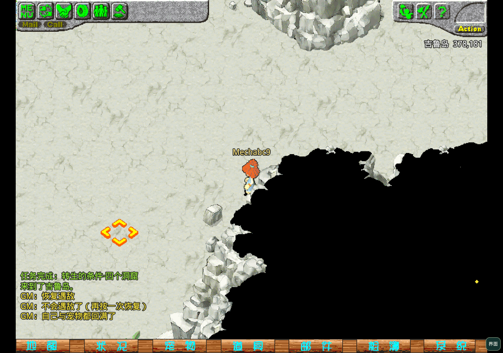
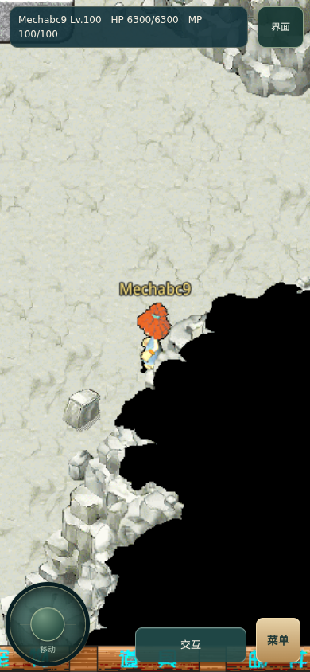
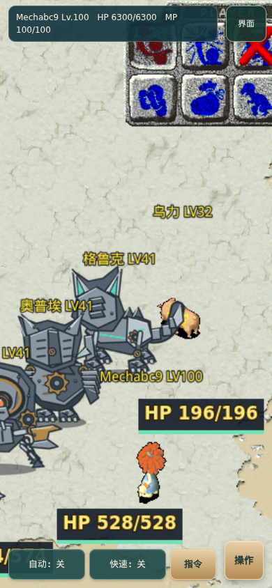

# SA-1113-04 · v0.2.11-LYNX 验收

> 基线 `31a8848` / v0.2.10-LYNX · 2026-11-13 UTC · Go 1.27.3 / Node 26.13.1

## 四项任务

| 任务 | 结果 | 关键证据 |
| --- | --- | --- |
| ✅ 手机UI与动态按钮 | 原生行列对齐、44px按钮、独立滚动、稳定节点；沉浸抽屉主菜单排在社交长列表前，位置按模式/朝向独立保存 | [移动审查](MOBILE.md)、[位置/滚动回归](browser/control-layout-after.json)、[真实游戏矩阵](browser/final-real-game.json) |
| ✅ 自动/快速战斗及组队 | 实际MP/场景/目标合法；多人捕捉协作，重定向、范围、反击与Guardian伤害边界；观战与跟随战斗互斥，敌人权重缓存与技能目标修正 | [战斗审查](COMBAT.md)、完整Go与race；真实手动/自动/快速战斗的BattleTurn和胜利 |
| ✅ 服务端效率与可靠性 | 不可变广播复用、有界内嵌gzip、真正排空人物/共享家族队列、已取未投邮件原子恢复，多线路不重复创建家族worker | [服务端审查](SERVER.md)、[交叉审查](CROSS-REVIEW.md)、慢SQLite人物与家族失败/修后记录 |
| ✅ 独立手机全屏模式 | 保留经典和桌面；等比原像素以上放大、智能镜头、默认收起遮挡人物的指令、明确操作入口、完整菜单预览及可退出全屏 | 29项真实游戏矩阵、实际人物模型默认覆盖率0、[镜头审查](CAMERA-REVIEW.md) |

## 验证范围

- 全部Go包测试通过；独立完整 `go test -race -count=1 -buildvcs=false ./...` **退出0**，313.146秒，源码输入摘要前后一致，见 [状态记录](go-race-final.json) 与 [日志](go-race-final.txt)。首轮工具会话143中断没有当作成功证据。
- 客户端与构建边界 **128/128**；入口TypeScript、Go vet、增量golangci-lint 0 issues。已有无关全量lint条目在专项报告中说明，未扩大清理。
- 真实Chromium156、SwiftShader软件GPU、真实发行ELF、完整本地官方资源、SQLite/WebSocket与私有测试账号。业务修改通过UI或隔离GM聊天，未注入战斗事件。不同桌面/手机浏览器上下文独立认证。
- 桌面1280×900原生鼠标菜单；手机320×568、390×844、430×932、844×390、568×320的经典/沉浸画面；道具、宠物、状态、任务、地图、系统、返回；摇杆移动/释放、短横屏按钮滑动、普通战斗子菜单、目标、结果关闭、自动/快速的服务端ACK和实际回合，**29项矩阵通过**。正常人物边界不被默认指令sheet遮挡，覆盖率0。
- 已取证并修复的发行候选问题：合法走廊上双指之后仍wantDir=2且移动、held-repeat继续；胜利结果返回无效；自身模型被sheet遮挡100%；长社交列表挤掉主菜单。保留候选JSON/PNG，最终记录独立标识二进制摘要。
- 最终内嵌HTTP验证覆盖HTML、40个JS、PNG，字节逐一匹配，gzip单层解码、q=0排除、ETag/304、HEAD空体和11个私密URL404；既有素材补丁及其文件摘要一致。见 [HTTP证据](binary-http-verification.json) 与 [实际停服](binary-http-shutdown.json)。
- 本机微基准：1000观察者移动分配1000→1，32000B→32B；敌人策略稳态17分配/约886B→0；同payload内嵌HTTP gzip处理耗时约下降89%–94%。这些数字不代表真人容量或全服CPU百分比。
- 慢盘真实main案例：人物10秒提前退出且丢2角色最新位置→约16秒排空后4角色位置一致；家族末值8000只写5000→等待剩余队列后8000保存。单有/共享/替换worker、32 Do+32 Flush并发取消和邮件满容量/整批回滚均有回归。

## 发行产物

最终摘要、文件大小、ZIP完整性和内嵌二进制一致性以 [release.json](release.json) 为准；匹配源码/客户端的输入指纹见 [FINAL-INPUTS.json](FINAL-INPUTS.json)。完整构建关闭瞬时Git dirty/revision印记，由版本与输入记录识别发行；相同输入重复Linux构建的SHA一致。

交付包含 `bin/saserver`、`bin/saserver.sha256` 与 `bin/saserver-v0.2.11-LYNX-linux-amd64.zip`。原版Assets没有追加或纳入Git；既有四宠增量包继续留在update/。ZIP排除数据库、凭据、本机配置和Assets全集。源码、README、发布说明、日志与任务文件一起提交远端。

## 实际限制

浏览器移动视口/触摸模拟**不是实体手机认证**。具体iOS/Android键盘、安全区、Safari音频和真实GPU仍需设备复核。没有宣称全部NPC/职业/道具或所有游戏内容经过手工游玩，也没有真人5000并发认证。

SQLite仍是单机单写者；每笔数据库操作有5秒期限，磁盘错误单独记录，队列排空不等于所有I/O成功。SIGKILL、断电、多节点容灾和硬件故障不在已证明范围。邮件没有客户端应用ACK，检查在线到真正收到之间仍有网络损失边界；HTTP Shutdown不表示所有WebSocket已经join。本批保证已验证的世界/存档队列关闭顺序及明确的复现范围。

## 实际游戏画面

| 桌面完整场景 | 手机沉浸场景 |
| --- | --- |
|  |  |

